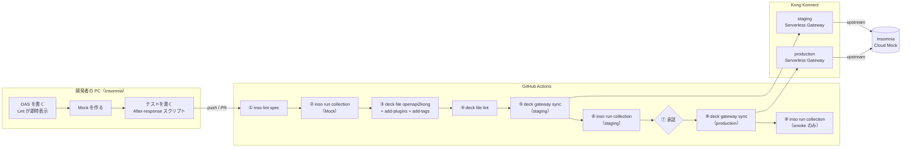

# Insomnia APIOps デモ — KongAir Flights API

**Insomnia / Inso CLI**、**decK**、**Kong Konnect** を GitHub Actions でつなぎ、
「API 仕様（OAS）を書く → チェックする → テストする → Gateway に反映する → 反映後にテストする」
までを自動化するサンプルです。

Insomnia で作った **OAS・Lint ルール・テストコレクション** が、そのまま CI/CD の品質ゲートとして使われることを示すのが目的です。

> [!NOTE]
> 本リポジトリはデモ用です。OAS とテストコレクションはファイルとして直接置いていますが、実際の運用では Insomnia のプロジェクトを **Git Sync** でこのようなリポジトリに接続し、「Insomnia で編集 → コミット → PR → パイプライン」という流れにするのが自然です。

---

## 全体像



| ステップ | 実施内容 | 何を確認するか |
| --- | --- | --- |
| ① | `inso lint spec`（`.spectral.yaml` のルールを適用） | OAS が社内の設計ルールに沿っているか（operationId・説明・タグ・連絡先の有無、パスの書き方など） |
| ② | `inso run collection --env env_mock` | Mock が OAS の約束どおりに返すか（4 リクエスト・21 テスト） |
| ③ | `deck file openapi2kong` → `add-plugins` → `add-tags` | OAS から Gateway の設定を生成（Service 1 つ、Route 3 本、Plugin 2 つ） |
| ④ | `deck file lint` | 生成した設定がガバナンスのルールを満たしているか（接続先が HTTPS か、rate-limiting があるか） |
| ⑤ | `deck gateway sync`（staging の Control Plane） | 生成した設定を staging の Gateway に反映 |
| ⑥ | `inso run collection --env env_staging` | Gateway を通しても正しく動き、ポリシー（rate-limiting、correlation-id）が効いているか（4 リクエスト・29 テスト） |
| ⑦ | GitHub Environments（production に承認者を設定） | 本番に反映してよいか、人が判断して承認する |
| ⑧ | `deck gateway sync`（production の Control Plane） | 同じ設定を production の Gateway に反映 |
| ⑨ | `inso run collection --env env_production --requestNamePattern smoke` | 本番でも最低限動くか（名前に「smoke」を含む 1 リクエストだけを実行） |

Pull Request のときは ①〜④ に加えて、**`deck gateway diff` の結果を PR にコメント**します（staging に何が反映されるかをレビューで確認できます）。⑤ 以降は `main` への push のときだけ実行されます。

実際の実行結果は [Actions の実行履歴](https://github.com/kg-yosuke/insomnia-apiops-demo/actions/runs/41599146649) で確認できます。

---

## リポジトリ構成

```
.
├── openapi.yaml                  # API 仕様（Single Source of Truth）
├── .spectral.yaml                # OAS の設計ルール（Insomnia のエディタと inso lint spec で共通）
├── insomnia/
│   └── flights-tests.yaml        # テストコレクション（Insomnia v5 形式、環境 mock / staging / production 付き）
├── kong/
│   ├── plugins.yaml              # OAS から生成した設定に追加する Gateway のポリシー
│   └── governance.yaml           # deck file lint 用のガバナンスルール
└── .github/
    ├── workflows/apiops.yaml     # パイプライン本体
    └── scripts/install-tools.sh  # Inso CLI と decK のインストール
```

### `openapi.yaml` — API 仕様

KongAir の Flights API（`GET /flights`、`POST /flights`、`GET /flights/{flightNumber}`）を定義しています。
`servers` には Gateway の転送先（upstream）として **Insomnia の Cloud Mock** の URL を指定しており、③ の `openapi2kong` で Kong の Service の接続先になります。

### `.spectral.yaml` — 設計ルール

Spectral の OAS 標準ルール（`spectral:oas`）に、次の社内ルールを追加しています。

- `operationId`、`description`、`tags`、`info.contact` を必須（error）にする
- パスは小文字のケバブケースにする（`paths-kebab-case`）

同じファイルが、Insomnia のエディタ上の Lint と CI の `inso lint spec` の両方で使われるため、**手元で通ればCIでも通る**状態になります。`inso lint spec ./openapi.yaml` のようにファイルを指定すると、同じフォルダにある `.spectral.yaml` が自動で読み込まれます。

### `insomnia/flights-tests.yaml` — テストコレクション

Insomnia にそのままインポートできる v5 形式のコレクションです。

| リクエスト | 内容 | 主なテスト |
| --- | --- | --- |
| `[smoke] List flights` | `GET /flights` | ステータス 200、2 件返る、各要素が `number` / `from` / `to` を持つ |
| `Get flight` | `GET /flights/{{ _.flight_number }}` | 前のリクエストで保存した便名の詳細が返る（リクエスト間の値の受け渡し） |
| `Create flight` | `POST /flights` | ステータス 201、`created: true` |
| `Get unknown flight (404)` | `GET /flights/XX0000` | ステータス 404、エラーメッセージ（異常系） |

フォルダ `Flights` の After-response スクリプトに**全リクエスト共通のテスト**を置いています。

- レスポンスタイムが 5000ms 未満
- ボディが正しい JSON で、`Content-Type` が `application/json`
- **Gateway 経由のときだけ**（環境変数 `via_gateway` が true）、`X-RateLimit-Limit-Minute: 60` と `X-Correlation-ID` が返ること

環境は 3 つあり、**同じテストを送り先だけ変えて使い回します**。

| 環境 | `base_url` | `via_gateway` | 使う場面 |
| --- | --- | --- | --- |
| `mock` | Insomnia Cloud Mock | false | ② PR の段階での契約テスト |
| `staging` | staging の Gateway | true | ⑥ 反映後の E2E テスト |
| `production` | production の Gateway | true | ⑨ スモークテスト |

Mock に直接送ると 21 テスト、Gateway 経由では Gateway のポリシーのテストが加わって 29 テストになります。

### `kong/plugins.yaml` — Gateway のポリシー

`deck file add-plugins` で、生成した Service に次のプラグインを追加します。

- `rate-limiting`（1 分あたり 60 リクエスト）
- `correlation-id`（`X-Correlation-ID` ヘッダーを付与してクライアントにも返す）

### `kong/governance.yaml` — ガバナンスルール

`deck file lint` で、生成した Kong の設定に対して次をチェックします。

- upstream が HTTPS であること
- すべての Service に `rate-limiting` が付いていること

`plugins.yaml` から rate-limiting を外すと、このステップで失敗します。

### `.github/workflows/apiops.yaml` — パイプライン

| ジョブ | 実行タイミング | 内容 |
| --- | --- | --- |
| `build` | PR / `main` への push | ①〜④。生成した `kong.yaml` を成果物として後続のジョブに渡す |
| `diff` | PR のみ | `deck gateway diff` の結果を PR にコメント |
| `deploy-staging` | `main` への push | ⑤⑥ |
| `deploy-production` | `deploy-staging` の成功後 | ⑦（承認待ち）⑧⑨ |

`deck gateway sync` / `diff` には `--select-tag flights-api` を付けています。Control Plane 上の**ほかのチームの Service や Route を消したり上書きしたりしない**ための、実運用で重要な設定です。

---

## 手元で試す

[Inso CLI](https://developer.konghq.com/inso-cli/) と [decK](https://developer.konghq.com/deck/) をインストールしたうえで、リポジトリのルートで実行します。CI の ①〜④ と同じ内容です。

```bash
# ① OAS の Lint
inso lint spec ./openapi.yaml

# ② Mock に対するテスト
inso run collection wrk_flights_tests -w insomnia/flights-tests.yaml --env env_mock

# ③ OAS から Kong の設定を生成
deck file openapi2kong -s openapi.yaml \
  | deck file add-plugins kong/plugins.yaml \
  | deck file add-tags flights-api -o kong.yaml

# ④ Kong の設定の Lint
deck file lint -s kong.yaml kong/governance.yaml
```

テストが 1 件でも失敗すると `inso` は終了コード 1 を返すため、CI ではそこでジョブが止まります。

### Insomnia で開く

1. Insomnia で **Import** → `insomnia/flights-tests.yaml` を選択
2. 環境を `mock` に切り替えて、コレクションの **Run**（Collection Runner）を実行
3. 各リクエストの **Scripts** タブ（Pre-request / After-response）でテストの中身を確認・編集

---

## 自分の環境で動かす

### 1. Konnect の準備

- Serverless Gateway の Control Plane を 2 つ作成（例：`staging`、`production`）
- それぞれの Proxy URL を控える
- Personal Access Token（PAT）を発行

### 2. Mock の準備

Insomnia で Cloud Mock を作り、次の 4 ルートを登録します。レスポンスヘッダーにはすべて `Content-Type: application/json` を付けてください。

| Method | Path | Status | Body |
| --- | --- | --- | --- |
| GET | `/flights` | 200 | `[{"number":"KA0284","from":"LHR","to":"SFO"},{"number":"KA0285","from":"SFO","to":"LHR"}]` |
| GET | `/flights/KA0284` | 200 | `{"number":"KA0284","from":"LHR","to":"SFO","status":"on-time"}` |
| POST | `/flights` | 201 | `{"number":"KA0999","created":true}` |
| GET | `/flights/XX0000` | 404 | `{"error":"flight not found"}` |

Mock の URL を `openapi.yaml` の `servers` と、`insomnia/flights-tests.yaml` の `mock` 環境の `base_url` に設定します。

### 3. GitHub の設定

**Secrets**

| 名前 | 値 |
| --- | --- |
| `KONNECT_PAT` | Konnect の PAT |

```bash
gh secret set KONNECT_PAT --repo <owner>/<repo>
# "Paste your secret:" と聞かれたら PAT を貼り付ける（名前の位置に PAT を書かないこと）
```

**Variables**

| 名前 | 例 |
| --- | --- |
| `KONNECT_ADDR` | `https://us.api.konghq.com`（Konnect のリージョンに合わせる） |
| `STAGING_CP` | `staging` |
| `PRODUCTION_CP` | `production` |
| `STAGING_PROXY_URL` | `https://xxxxxxxxxx.us.serverless.gateways.konggateway.com` |
| `PRODUCTION_PROXY_URL` | `https://xxxxxxxxxx.us.serverless.gateways.konggateway.com` |

**Environments**

- `staging`
- `production`（**Required reviewers** に承認者を設定）

### 4. 実行

`main` に push するとパイプラインが動き、`deploy-production` の手前で承認待ちになります。Actions の画面で **Review deployments** → **Approve and deploy** を押すと本番に反映されます。

---

## ハマりどころ

| 症状 | 原因と対処 |
| --- | --- |
| `deck gateway sync` が `HTTP status 401` | Secret に登録した PAT が無効。`gh secret set` の名前と値の取り違えや、取り消し済みの PAT が入っていないか確認する |
| Mock に対するテストで `body is valid JSON` / `JSON response` が失敗 | Mock ルートのボディが空、または `Content-Type: application/json` が付いていない。修正後、各ルートで **Send** を押して Cloud Mock に反映する |
| スクリプトで `insomnia.response.headers.get('Content-Type')` が `undefined` | ヘッダー名の検索が大文字・小文字を区別するため。本リポジトリでは `headers.find(h => h.key.toLowerCase() === ...)` で回避している |
| Inso のダウンロードに失敗 | Inso のリリースタグは `core@<version>`（例：`core@13.3.1`） |

---

## 参考リンク

- [Insomnia](https://insomnia.rest/)
- [Inso CLI](https://developer.konghq.com/inso-cli/) / [リファレンス](https://developer.konghq.com/inso-cli/reference/)
- [decK](https://developer.konghq.com/deck/)
- [Insomnia のスクリプト](https://developer.konghq.com/insomnia/scripts/)
- [Insomnia の Mock](https://developer.konghq.com/insomnia/mock-servers/)
- [Kong Konnect](https://konghq.com/products/kong-konnect)
