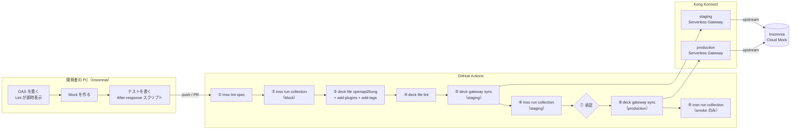

# Insomnia APIOps デモ — KongAir Flights API

**Insomnia / Inso CLI**、**decK**、**Kong Konnect** を GitHub Actions でつなぎ、
「API 仕様（OAS）を書く → チェックする → テストする → Gateway に反映する → 反映後にテストする」
までを自動化するサンプルです。

Insomnia で作った **OAS・Lint ルール・テストコレクション** が、そのまま CI/CD の品質ゲートとして使われることを体験できます。

**必要なものが少ない順に 3 段階で試せます。** Level 1 と Level 2 は Kong Konnect がなくても動きます。

| レベル | 必要なもの | できること | 目安 |
| --- | --- | --- | --- |
| [Level 1：手元で試す](#level-1手元で試す) | Insomnia（Mock 作成のためにアカウントが必要）、Inso CLI、decK | Mock を作り、Lint・テスト・Kong の設定生成を手元で実行 | 15 分 |
| [Level 2：CI で試す](#level-2ci-で試す) | ＋ GitHub アカウント | fork して、PR や push で Lint・テスト・設定生成を自動実行 | ＋10 分 |
| [Level 3：Gateway まで](#level-3gateway-まで) | ＋ Kong Konnect（無償トライアル可） | staging / production の Gateway へ反映し、E2E テスト・承認・スモークテストまで | ＋20 分 |

> [!NOTE]
> 本リポジトリはデモ用です。OAS とテストコレクションはファイルとして置いていますが、実際の運用では Insomnia のプロジェクトを **Git Sync** でこのようなリポジトリに接続し、「Insomnia で編集 → コミット → PR → パイプライン」という流れにするのが自然です。

---

## 全体像



| ステップ | 実施内容 | 何を確認するか | レベル |
| --- | --- | --- | --- |
| ① | `inso lint spec`（`.spectral.yaml` のルールを適用） | OAS が社内の設計ルールに沿っているか（operationId・説明・タグ・連絡先の有無、パスの書き方など） | 1〜 |
| ② | `inso run collection --env env_mock` | Mock が OAS の約束どおりに返すか（4 リクエスト・21 テスト） | 1〜 |
| ③ | `deck file openapi2kong` → `add-plugins` → `add-tags` | OAS から Gateway の設定を生成（Service 1 つ、Route 3 本、Plugin 2 つ） | 1〜 |
| ④ | `deck file lint` | 生成した設定がガバナンスのルールを満たしているか（接続先が HTTPS か、rate-limiting があるか） | 1〜 |
| ⑤ | `deck gateway sync`（staging の Control Plane） | 生成した設定を staging の Gateway に反映 | 3 |
| ⑥ | `inso run collection --env env_staging` | Gateway を通しても正しく動き、ポリシー（rate-limiting、correlation-id）が効いているか（4 リクエスト・29 テスト） | 3 |
| ⑦ | GitHub Environments（production に承認者を設定） | 本番に反映してよいか、人が判断して承認する | 3 |
| ⑧ | `deck gateway sync`（production の Control Plane） | 同じ設定を production の Gateway に反映 | 3 |
| ⑨ | `inso run collection --env env_production --requestNamePattern smoke` | 本番でも最低限動くか（名前に「smoke」を含む 1 リクエストだけを実行） | 3 |

Pull Request のときは ①〜④ に加えて、**`deck gateway diff` の結果を PR にコメント**します（staging に何が反映されるかをレビューで確認できます）。⑤ 以降は `main` への push のときだけ実行されます。

---

## Level 1：手元で試す

### 準備

- [Insomnia](https://insomnia.rest/download)（Cloud Mock を作るため、サインインしてください）
- [Inso CLI](https://developer.konghq.com/inso-cli/)（例：`brew install inso`）
- [decK](https://developer.konghq.com/deck/)（例：`brew install kong/deck/deck`）
- このリポジトリを clone

```bash
git clone https://github.com/kg-yosuke/insomnia-apiops-demo.git
cd insomnia-apiops-demo
```

### 1. Mock を作る

1. Insomnia で **Import** を選び、[`insomnia/flights-mock.yaml`](insomnia/flights-mock.yaml) を読み込みます。「Flights Mock」という Mock Server ができます。
2. Mock Server を開き、**4 つのルートそれぞれで一度 Send（Test）を押します**。ここで初めて Cloud Mock にルートが登録されます。
3. URL バーに表示される `https://mock-xxxxxxxx.mock.insomnia.run/...` のうち、パスより前（`https://mock-xxxxxxxx.mock.insomnia.run`）を控えます。

Mock の中身は次のとおりです（インポートせずに手で作る場合も、この内容で作ってください）。

| Method | Path | Status | Body |
| --- | --- | --- | --- |
| GET | `/flights` | 200 | `[{"number":"KA0284","from":"LHR","to":"SFO"},{"number":"KA0285","from":"SFO","to":"LHR"}]` |
| GET | `/flights/KA0284` | 200 | `{"number":"KA0284","from":"LHR","to":"SFO","status":"on-time"}` |
| POST | `/flights` | 201 | `{"number":"KA0999","created":true}` |
| GET | `/flights/XX0000` | 404 | `{"error":"flight not found"}` |

すべてのルートのレスポンスヘッダーに `Content-Type: application/json` を付けます。

> [!TIP]
> 「Create a new Mock Server」の画面で **AI による自動生成（Auto Generate）** を選ぶと、ホスト先は Self-Hosted に限られます。このデモでは Cloud Mock を使うため、インポートか手作業で作成してください。

### 2. Lint・テスト・設定生成を実行する

控えた Mock の URL を環境変数に入れてから、リポジトリのルートで実行します。CI の ①〜④ と同じ内容です。

```bash
export MOCK_URL=https://mock-xxxxxxxx.mock.insomnia.run

# ① OAS の Lint
inso lint spec ./openapi.yaml

# ② Mock に対するテスト
inso run collection wrk_flights_tests -w insomnia/flights-tests.yaml \
  --env env_mock --env-var "base_url=$MOCK_URL"

# ③ OAS から Kong の設定を生成（upstream を自分の Mock に置き換えて）
sed "s#https://YOUR-MOCK-ID.mock.insomnia.run#$MOCK_URL#" openapi.yaml \
  | deck file openapi2kong -s - \
  | deck file add-plugins kong/plugins.yaml \
  | deck file add-tags flights-api -o kong.yaml

# ④ Kong の設定の Lint
deck file lint -s kong.yaml kong/governance.yaml
```

### こうなれば成功

```text
① No linting errors or warnings.
② Test Requests: 4 passed, 4 total
   Tests:         21 passed, 21 total
④ （何も表示されずに終了）
```

`kong.yaml` には Service 1 つ（接続先は自分の Mock）、Route 3 本、Plugin 2 つ（rate-limiting、correlation-id）が入っています。

### わざと失敗させてみる

品質ゲートが働くことを確かめてみましょう。どれも終了コード 1 で止まります。

| やること | 止まる場所 |
| --- | --- |
| `openapi.yaml` のどれかの operation から `description` を消す | ① `inso lint spec` |
| Mock の `GET /flights` のボディを 1 件だけにする（Send で反映） | ② `returns 2 flights` が失敗 |
| `kong/plugins.yaml` から `rate-limiting` を消す | ④ `deck file lint` |

### Insomnia でテストを見る

1. Insomnia で **Import** → [`insomnia/flights-tests.yaml`](insomnia/flights-tests.yaml) を読み込みます。
2. 環境 `mock` を選び、`base_url` を自分の Mock の URL に書き換えます。
3. コレクションの **Run**（Collection Runner）を実行します。
4. 各リクエストやフォルダの **Scripts** タブ（Pre-request / After-response）で、テストの中身を確認できます。

---

## Level 2：CI で試す

1. このリポジトリを **fork** します。
2. fork したリポジトリの **Settings → Secrets and variables → Actions → Variables** に `MOCK_URL` を登録します（値は Level 1 で控えた Mock の URL）。
3. **Actions** タブでワークフローを有効にし、`APIOps - Flights API` を **Run workflow** で実行します（またはファイルを少し変えて push / PR）。

### こうなれば成功

`build` ジョブが緑になり、①〜④ が実行されます。`KONNECT_PAT` を登録していないため、`diff`・`deploy-staging`・`deploy-production` は **自動でスキップ** されます（エラーにはなりません）。

PR を作って、Level 1 の「わざと失敗させてみる」を試すと、PR のチェックが赤になる様子を確認できます。

---

## Level 3：Gateway まで

### 1. Konnect の準備

- Serverless Gateway の Control Plane を 2 つ作成します（例：`staging`、`production`）。
- それぞれの **Proxy URL**（`https://xxxxxxxxxx.<region>.serverless.gateways.konggateway.com`）を控えます。
- **Personal Access Token（PAT）** を発行します。

### 2. GitHub の設定

**Secrets**

| 名前 | 値 |
| --- | --- |
| `KONNECT_PAT` | Konnect の PAT |

GitHub CLI で登録する場合は、次のように実行し、`Paste your secret:` と聞かれたら PAT を貼り付けます（コマンドの名前の位置に PAT を書かないよう注意してください）。

```bash
gh secret set KONNECT_PAT --repo <owner>/<repo>
```

**Variables**（Level 2 の `MOCK_URL` に加えて）

| 名前 | 例 |
| --- | --- |
| `KONNECT_ADDR` | `https://us.api.konghq.com`（Konnect のリージョンに合わせる） |
| `STAGING_CP` | `staging` |
| `PRODUCTION_CP` | `production` |
| `STAGING_PROXY_URL` | staging の Proxy URL |
| `PRODUCTION_PROXY_URL` | production の Proxy URL |

**Environments**（Settings → Environments）

- `staging`
- `production`：**Required reviewers** に承認者を設定します。設定しない場合は、承認なしで本番まで自動で反映されます。

### 3. 実行

`main` に push（または Run workflow）すると、⑤ staging への反映と ⑥ E2E テストが実行され、`deploy-production` の手前で **承認待ち** になります。Actions の画面で **Review deployments** → **Approve and deploy** を押すと、⑧ 本番への反映と ⑨ スモークテストが実行されます。

### こうなれば成功

- ⑤ `deck gateway sync` の結果に `Created: 6`（Service 1、Route 3、Plugin 2）
- ⑥ `Tests: 29 passed, 29 total`
  - Mock に直接送ったとき（21 テスト）より 8 件多いのは、Gateway 経由のときだけ有効になるテスト（`X-RateLimit-Limit-Minute` と `X-Correlation-ID` の確認 × 4 リクエスト）が加わるためです。
- ⑨ `Test Requests: 1 passed, 1 total`

反映後に Insomnia の **Konnect 連携** で同期すると、追加された Route が Insomnia 上にリクエストとして現れます。

---

## リポジトリ構成

```
.
├── openapi.yaml                  # API 仕様（Single Source of Truth）。upstream は CI で MOCK_URL に置き換え
├── .spectral.yaml                # OAS の設計ルール（Insomnia のエディタと inso lint spec で共通）
├── insomnia/
│   ├── flights-mock.yaml         # Mock Server（Insomnia にインポートして使う）
│   └── flights-tests.yaml        # テストコレクション（環境 mock / staging / production 付き）
├── kong/
│   ├── plugins.yaml              # OAS から生成した設定に追加する Gateway のポリシー
│   └── governance.yaml           # deck file lint 用のガバナンスルール
└── .github/
    ├── workflows/apiops.yaml     # パイプライン本体
    └── scripts/
        ├── install-tools.sh      # Inso CLI と decK のインストール
        └── wait-for-gateway.sh   # 反映後、Gateway が応答するまで待つ（Serverless のコールドスタート対策）
```

### `openapi.yaml` — API 仕様

KongAir の Flights API（`GET /flights`、`POST /flights`、`GET /flights/{flightNumber}`）を定義しています。
`servers` の `https://YOUR-MOCK-ID.mock.insomnia.run` は仮の値で、CI では Variables の `MOCK_URL` に置き換えてから ③ の `openapi2kong` で Kong の Service の接続先（upstream）にします。

### `.spectral.yaml` — 設計ルール

Spectral の OAS 標準ルール（`spectral:oas`）に、次の社内ルールを追加しています。

- `operationId`、`description`、`tags`、`info.contact` を必須（error）にする
- パスは小文字のケバブケースにする（`paths-kebab-case`）

同じファイルが Insomnia のエディタ上の Lint と CI の `inso lint spec` の両方で使われるため、**手元で通れば CI でも通る** 状態になります。`inso lint spec ./openapi.yaml` のようにファイルを指定すると、同じフォルダにある `.spectral.yaml` が自動で読み込まれます。

### `insomnia/flights-tests.yaml` — テストコレクション

| リクエスト | 内容 | 主なテスト |
| --- | --- | --- |
| `[smoke] List flights` | `GET /flights` | ステータス 200、2 件返る、各要素が `number` / `from` / `to` を持つ |
| `Get flight` | `GET /flights/{{ _.flight_number }}` | 前のリクエストで保存した便名の詳細が返る（リクエスト間の値の受け渡し） |
| `Create flight` | `POST /flights` | ステータス 201、`created: true` |
| `Get unknown flight (404)` | `GET /flights/XX0000` | ステータス 404、エラーメッセージ（異常系） |

フォルダ `Flights` の After-response スクリプトに **全リクエスト共通のテスト** を置いています。

- レスポンスタイムが 5000ms 未満
- ボディが正しい JSON で、`Content-Type` が `application/json`
- **Gateway 経由のときだけ**（環境変数 `via_gateway` が true）、`X-RateLimit-Limit-Minute: 60` と `X-Correlation-ID` が返ること

環境は 3 つあり、**同じテストを送り先だけ変えて使い回します**。`base_url` は CI では `--env-var` で上書きするため、ファイルには仮の値が入っています。

| 環境 | `base_url` | `via_gateway` | 使う場面 |
| --- | --- | --- | --- |
| `mock` | Insomnia Cloud Mock（`MOCK_URL`） | false | ② PR の段階での契約テスト |
| `staging` | staging の Gateway（`STAGING_PROXY_URL`） | true | ⑥ 反映後の E2E テスト |
| `production` | production の Gateway（`PRODUCTION_PROXY_URL`） | true | ⑨ スモークテスト |

本番（⑨）で全リクエストを流さないのは、`POST` のように副作用のあるリクエストを本番で実行しないためです。

### `kong/plugins.yaml` — Gateway のポリシー

`deck file add-plugins` で、生成した Service に次のプラグインを追加します。

- `rate-limiting`（1 分あたり 60 リクエスト）
- `correlation-id`（`X-Correlation-ID` ヘッダーを付与してクライアントにも返す）

### `kong/governance.yaml` — ガバナンスルール

`deck file lint` で、生成した Kong の設定に対して次をチェックします。

- upstream が HTTPS であること
- すべての Service に `rate-limiting` が付いていること

### `.github/workflows/apiops.yaml` — パイプライン

| ジョブ | 実行タイミング | 内容 |
| --- | --- | --- |
| `build` | PR / `main` への push / 手動実行 | ①〜④。生成した `kong.yaml` を成果物として後続のジョブに渡す |
| `diff` | PR のみ（`KONNECT_PAT` がある場合） | `deck gateway diff` の結果を PR にコメント |
| `deploy-staging` | `main` への push / 手動実行（`KONNECT_PAT` がある場合） | ⑤⑥ |
| `deploy-production` | `deploy-staging` の成功後 | ⑦（承認待ち）⑧⑨ |

`deck gateway sync` / `diff` には `--select-tag flights-api` を付けています。Control Plane 上の **ほかのチームの Service や Route を消したり上書きしたりしない** ための、実運用で重要な設定です。

---

## ハマりどころ

| 症状 | 原因と対処 |
| --- | --- |
| `build` が `Repository variable MOCK_URL is not set` で失敗 | Variables に `MOCK_URL` を登録する（Secrets ではなく Variables） |
| ② で `body is valid JSON` / `JSON response` が失敗 | Mock ルートのボディが空、または `Content-Type: application/json` が付いていない。修正後、各ルートで **Send** を押して Cloud Mock に反映する |
| ② で全リクエストが接続エラー | インポート後に各ルートで Send を押していない（Cloud Mock にルートが登録されていない） |
| ⑥ / ⑨ で最初のリクエストが `Timeout was reached` | Serverless Gateway は、しばらくアクセスがないと最初の 1 回の応答に 10〜20 秒以上かかります（コールドスタート）。本リポジトリでは `wait-for-gateway.sh` で 200 が返るまで待ってからテストを実行しています |
| `deck gateway sync` が `HTTP status 401` | Secret の PAT が無効。`gh secret set` の名前と値の取り違えや、取り消し済みの PAT が入っていないか確認する |
| スクリプトで `insomnia.response.headers.get('Content-Type')` が `undefined` | ヘッダー名の検索が大文字・小文字を区別するため。本リポジトリでは `headers.find(h => h.key.toLowerCase() === ...)` で回避している |
| Inso のダウンロードに失敗 | Inso のリリースタグは `core@<version>`（例：`core@13.3.1`） |

---

## 参考リンク

- [Insomnia](https://insomnia.rest/)
- [Inso CLI](https://developer.konghq.com/inso-cli/) / [リファレンス](https://developer.konghq.com/inso-cli/reference/)
- [decK](https://developer.konghq.com/deck/)
- [Insomnia のスクリプト](https://developer.konghq.com/insomnia/scripts/)
- [Insomnia の Mock](https://developer.konghq.com/insomnia/mock-servers/)
- [Kong Konnect](https://konghq.com/products/kong-konnect)
